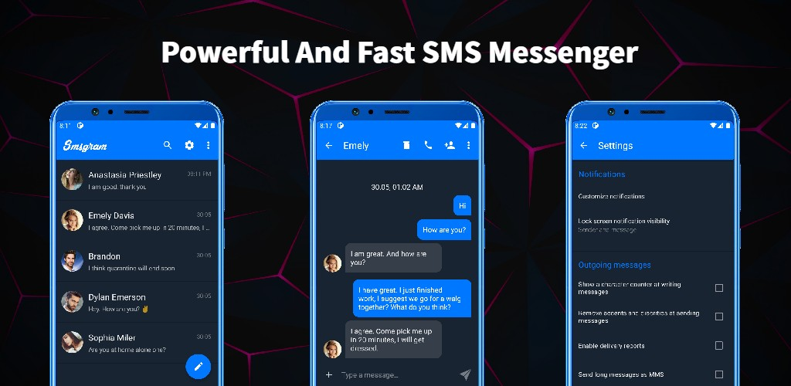

# Smsgram

[](./LICENSE)

> Historical Android project. Smsgram's former Google Play release is no longer maintained, but the source remains public as a production messaging case study.

Smsgram is a native Android SMS and MMS client with a conversation-first interface. The final release supported everyday messaging, scheduled delivery, media attachments, search, notifications, backup and restore, and configurable messaging behavior.



## Engineering Highlights

- Kotlin application with separate activities, adapters, services, receivers, and data models
- SMS and MMS receive/send pipelines with delivery-status handling
- Scheduled messages and notification quick replies
- Room persistence for conversations and message attachments
- Import/export workflows for SMS and MMS backups
- Contact, vCard, attachment preview, and image-compression utilities
- Product flavors for core, F-Droid, and prepaid distributions
- Fastlane metadata and release assets for store delivery

## Architecture

```text
app/src/main/kotlin/com/favrora/prosms/
├── activities/     Conversation, search, settings, and viewer screens
├── adapters/       Lists for threads, contacts, search, and attachments
├── databases/      Room database configuration
├── helpers/        Messaging, backup, contacts, and media workflows
├── receivers/      SMS/MMS, delivery, scheduling, and quick-reply events
├── services/       Background messaging services
└── models/         Typed conversation and attachment models
```

## Build Snapshot

This repository preserves the final 2023 application configuration. Its original build depends on historical Android artifacts that are no longer available from every upstream repository. The commands below document the original local workflow rather than a supported modern release pipeline.

```bash
# In SMS-commons
./gradlew publishToMavenLocal

# In smsgram
./gradlew assembleCoreDebug
```

The project targets Android API 33 and requires JDK 17. Generated APK artifacts and signing files are intentionally excluded from source control.

## License

Released under the [GNU General Public License v3.0](./LICENSE).
